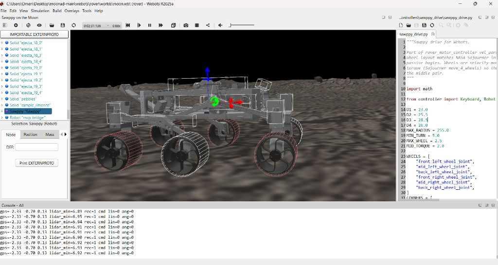
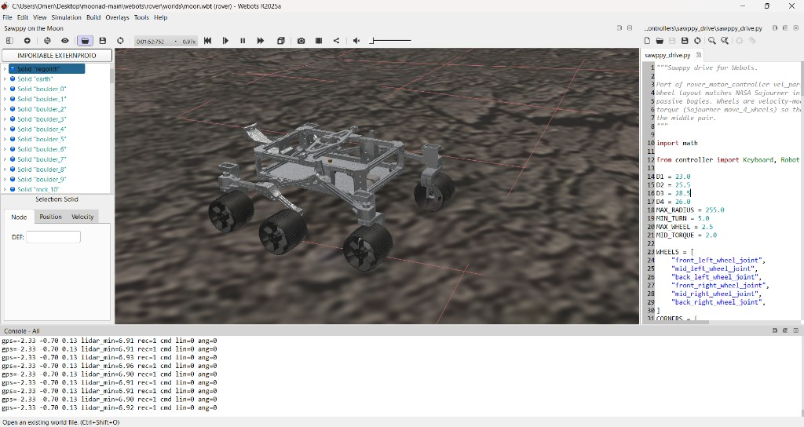
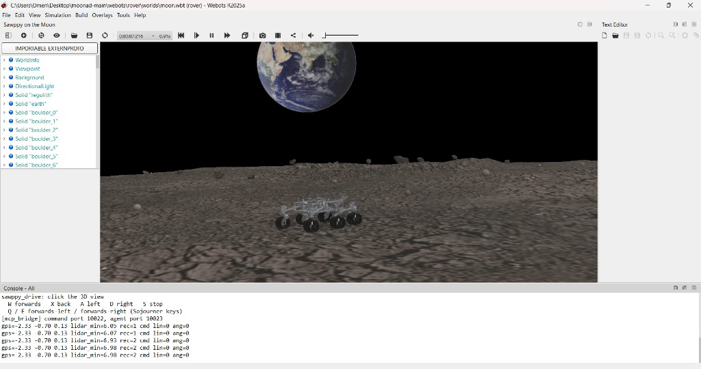

# Request for recognition and support

**To:** Web3 Clubs Kenya

**From:** [Name], Bachelor of Business Information Technology (BBIT), Class of 2024, Africa Nazarene University; Web3 Clubs member

**Date:** [Date]

**Contact:** [Email] · [Phone]

**Subject:** MOONAD — a lunar rover whose jobs can be checked and paid, for recognition and a lab demo

Dear Web3 Clubs,

I am a member of Web3 Clubs. I come to the lab from time to time for the sessions and the talks. I am writing from inside the club, asking you to recognise **MOONAD** as a project that uses a public record for a machine's work, to mentor me on how to explain that record to someone outside the club, to host a community demo, and to make introductions to builders who have shipped a machine identity people can look up.

MOONAD is a rover that does paid work and shares the earnings with people on Earth who helped fund it. In the project today, the rover lives in a computer model of the Moon. It drives, finds a sample, and returns to a landing pad. The trip is written as a log: online, travelling, sample found, sample delivered. The next step is to tie that log to a public identity and to release a payment only when the job is confirmed.

A signal from Earth to the Moon takes more than a second. The rover drives itself. The public record is the receipt, the payment, and the share. It arrives after the wheels have done the work.

## Why the record matters

Kenya is already building space skills. The Kenya Space Agency, set up in 2017, promotes and regulates space activity for national development. The country has flown small satellites, including 1KUNS-PF and Taifa-1, and the Agency trains students on CubeSats and on satellite data. A rover whose jobs can be checked is a graduate project in that line. The Agency has not adopted it.

The Web3 point is simple. A buyer far from the machine should be able to see that the job happened before the money moves. The people who paid to build the rover should be able to see their share. This letter is my own request.

The aims are a demo the lab can follow, a public record for the job once the test network step is done, and a later ground test. A rover on the Moon is further off. The letter stays with the demonstration and the record.

## What the demo holds

1. **Identity.** The rover is meant to have a public identity on peaq, so a job names a machine. That identity is the next step. The simulation writes the log locally today.
2. **A job that can be checked.** Online, traverse, sample found, sample delivered. A buyer pays when those marks are confirmed.
3. **A share.** Earnings go to the people on Earth who funded the rover, by a rule agreed with them first. The percentages stay blank here. Selling shares to the public waits on legal advice. The lab demo can show a test split.
4. **The wheels stay with the rover.** The machine plans its own path. The record does not drive it.

## Why this is a Web3 project

MOONAD is a machine service whose work, payment, and ownership share can be checked by someone who is not standing next to the rover. That is the Web3 use. The product is the job. I already come to the lab for sessions and talks. I need help saying these four points in plain language, and a demo in front of people who will say if the story is clear.

## The demo

*Caption: Simulation. The rover at work.*

*Caption: An aerial view of the rover on the simulated lunar surface.*

*Caption: The simulated lunar environment with the Earth in the background.*

**[Image: the rover beside a sample]**

*Caption: Simulation. Sample found, one line of the log.*

<video src="videos/rover-autonomous-lunar-surface.mp4" controls width="100%"></video>

*Caption: Recording of the rover moving autonomously on the simulated lunar surface. Simulation. Say on the slide that the public payment is the next step, and that the log is local today.*

## Why I can finish it

At the NIRU National AI Hackathon I built a drone project, [Earlier project name], and took it to a podium: [place, for example 2nd or 3rd, and the track if it was a category prize]. More than 5,600 people registered. The project was drone-based, and it succeeded. The airframe is still to be built. [One or two plain sentences on what the drone project did.]

*Caption: Presenting the drone project on stage at the NIRU National AI Hackathon.*

*Caption: Presenting the drone project at the NIRU National AI Hackathon.*

In April 2026 I presented that drone project at the 3rd Mashariki Cooperation Conference in Diani, hosted by the National Intelligence Service. In the room were His Excellency Dr. William Samoei Ruto, C.G.H., President of the Republic of Kenya; Hon. Onesimus Kipchumba Murkomen, Cabinet Secretary for Interior and National Administration; and Mr. Noordin Mohamed Haji, Director-General of the National Intelligence Service. I presented the project to that audience.

*Caption: Presenting the project to Hon. Onesimus Kipchumba Murkomen, Cabinet Secretary for Interior and National Administration, and Mr. Noordin Mohamed Haji, Director-General of the National Intelligence Service.*

*Caption: Presenting the project to His Excellency Dr. William Samoei Ruto, C.G.H., President of the Republic of Kenya.*

I have taken a drone project to a national podium, explained it to a Cabinet-level audience, and kept showing up at the Web3 Clubs lab. For the club, the finish line is a demo that shows the local log and the payment step still ahead, and a path that talks about the Moon only after a ground test.

## What I am asking

1. Recognition of MOONAD as a Web3 Clubs project worth showing: a rover job with a checkable record, from a member.
2. Mentorship on explaining identity, the job log, and the funders' share to a non-technical listener.
3. A community demo slot at the lab.
4. Introductions to builders who have given a machine a public identity people can look up.

## What the club gains

A demo with a machine as the user-facing story. The club can show a Kenyan project in which a rover's work, payment, and shared earnings are meant to be checked. The request in this letter is mine.

## Next step

I would like thirty minutes at the lab, with whoever programmes the sessions, to agree a date and which screens to show. I can also take that on a call.

Respectfully,

[Name]

Bachelor of Business Information Technology, Class of 2024

Africa Nazarene University

Web3 Clubs member

## Sources

- Kenya Space Agency: mandate under Legal Notice No. 22 of 7 March 2017; 1KUNS-PF and Taifa-1; student CubeSat and Earth-observation training in 2025 and 2026.
